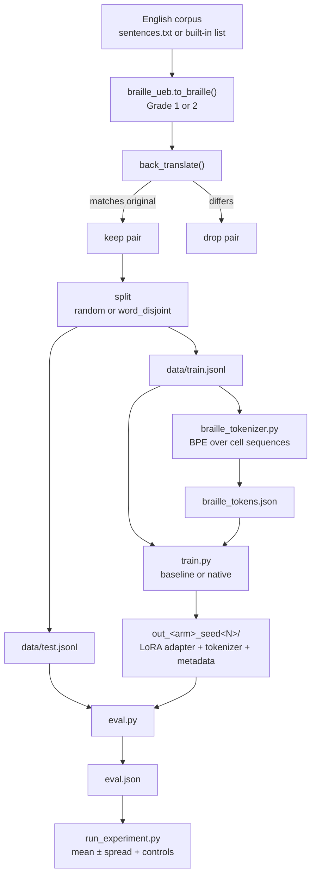
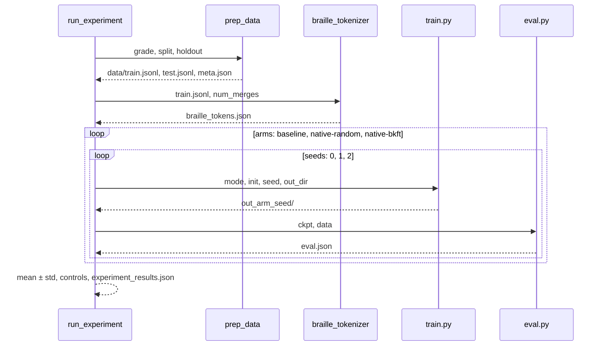

# Architecture

This document describes how BrailleLM is put together: the layers of the
system, the data and tensor shapes that move between them, the model adaptation
path, and the experiment orchestration. The README covers usage; this file
covers design.

---

## 1. System at a glance

BrailleLM is an offline experiment, not a service. It has three layers:

| Layer | Components | Question it answers |
|---|---|---|
| **Representation and data** | `braille_ueb.py`, `prep_data.py` | What exactly is a training pair, and is it correct? |
| **Model adaptation** | `braille_tokenizer.py`, `train.py` | How does a stock LM become a braille reader? |
| **Measurement** | `eval.py`, `run_experiment.py`, `run_all.py` | Did the adaptation help, and by how much? |

Everything is file-based: each stage reads JSON/JSONL from disk and writes
JSON/JSONL plus a checkpoint directory. There is no database, server, queue or
hidden state between stages. That makes each stage independently runnable and
inspectable.



---

## 2. Component responsibilities

| Component | Type | Reads | Writes | Depends on |
|---|---|---|---|---|
| `braille_ueb.py` | pure library | nothing | nothing | — |
| `prep_data.py` | CLI stage | corpus text, optional liblouis | `data/*.jsonl`, `data/meta.json` | `braille_ueb` |
| `braille_tokenizer.py` | CLI stage | `data/train.jsonl` | `braille_tokens.json` | — |
| `train.py` | CLI stage | data, tokens, base model | `out_*/` checkpoint | `braille_ueb` (BKFT) |
| `eval.py` | CLI stage | `out_*/`, `data/test.jsonl` | `out_*/eval.json` | transformers, peft, sacrebleu |
| `run_all.py` | orchestrator | flags | runs the two-arm smoke test | all of the above |
| `run_experiment.py` | orchestrator | flags | runs the 3×N matrix, `experiment_results.json` | all of the above |
| `test_wiring.py` | test | `data/train.jsonl`, `braille_tokens.json` | stdout | `train.py`, `braille_ueb` |

Dependency direction is strictly downward: the library never imports a stage,
and the stages never import the orchestrators. `train.py` is imported by
`test_wiring.py` for its `bkft_init`, `build_example` and `collate` functions,
which is why those functions are module-level rather than nested.

---

## 3. Data architecture

### 3.1 Pair construction

A pair is a JSON object with exactly two string fields:

```json
{"braille": "⠞⠓⠑ ⠟⠥⠊⠉⠅ ...", "print": "The quick ..."}
```

`prep_data.py` builds it in three steps:

1. Normalise whitespace.
2. Convert print → braille with `to_braille`.
3. Convert the result back with `back_translate` and keep the pair only if the
   round trip equals the original case-insensitively.

The invariant is therefore:

```text
back_translate(to_braille(s)).lower() == s.lower()
```

for every committed pair. This is stronger than checking the converter by eye,
and it means the labels are self-consistent by construction. The cost is that
anything the converter cannot represent is silently absent from the dataset
instead of becoming a wrong label.

### 3.2 Grade 1 versus Grade 2

- **Grade 1** maps each print letter, digit and listed punctuation mark to one
  cell, plus indicators for capitals and numbers. It is exact and invertible for
  the supported character set.
- **Grade 2** additionally replaces 18 common groupsigns (`the`, `and`, `ing`,
  `ch`, …) with single cells. The reverse direction expands each contraction to
  its most common letter sequence, which is enough for BKFT and for filtering,
  but it is **not** full UEB and cannot recover every contraction
  unambiguously.

The engine is deliberately small because it has to run anywhere. If liblouis is
importable, `prep_data.py` uses `unicode.dis` plus `en-ueb-g1.ctb` or
`en-ueb-g2.ctb` instead, and the rest of the pipeline is unchanged.

### 3.3 Splits

**Random split.** Shuffle pairs with a seeded RNG, take `test_frac` for test.
Train and test share vocabulary; this measures sentence-level generalisation.

**Word-disjoint split.** Build the vocabulary of `[a-z]+` tokens, shuffle it
with the same seeded RNG, hold out `holdout_frac` of it, and assign a sentence
to test if it contains at least one held-out word. The script then verifies:

```text
for every test pair: set(words(pair)) - train_vocab is not empty
```

That assertion is what makes the split meaningful. With the bundled corpus at
5%, it holds out 6 of 138 words and produces 459 train / 141 test pairs. Note
that the holdout fraction applies to *vocabulary*, not sentences, so the test
fraction is larger than 5%.

A consequence worth stating: because the corpus is templated, held-out words
recur in many sentence frames, so the test set is not a random sample of
English. It is a targeted test of whether the model can produce a word it never
saw, in frames it has seen.

### 3.4 Metadata

`data/meta.json` records the engine, grade, kept/dropped counts, split type,
vocabulary size, number of held-out words, and the
`every_test_has_unseen_word` assertion result. Reproducibility depends on this
file as much as on the JSONL.

---

## 4. Tokenizer architecture

The native tokenizer is not a Hugging Face tokenizer. It is a small, explicit
BPE trained from scratch over braille cell sequences.

### 4.1 Alphabet and boundaries

- The alphabet is the 64 six-dot cells `U+2800`–`U+283F`; `U+2800` (blank) acts
  as a word separator.
- Each training braille string becomes a sequence of single characters.
- At every merge iteration, adjacent pairs are counted **except** pairs touching
  a blank cell or newline. Merges never cross a word boundary.
- The most frequent pair is merged if it occurs at least twice; otherwise the
  loop stops early.

### 4.2 Token list

The saved token list is the union of:

1. every base cell that actually appears in `data/train.jsonl`,
2. the capital (`U+2820`), number (`U+283C`) and blank (`U+2800`) indicators
   when present,
3. every merged token, in merge order.

For the bundled corpus: 27 base cells + 150 merges = **177 tokens**. SmolLM2's
base vocabulary is 49,152, and all 177 are new, so `add_tokens` grows it to
**49,329**. The merge record is kept too, so the vocabulary can be audited (for
example, `⠓⠑ → "he"`, `⠞⠓⠑ → "the"`).

### 4.3 Why this design

- It is deterministic and dependency-free, so the data and vocabulary can be
  rebuilt on any machine.
- It keeps the tokenizer comparison honest: both native arms use exactly the
  same added tokens.
- It makes BKFT possible: every token is a cell sequence, and every cell
  sequence has a print expansion.

The trade-off is that it is corpus-specific. A different corpus or grade
produces a different vocabulary and must be retrained.

---

## 5. Model architecture

### 5.1 Base model

The default base is `HuggingFaceTB/SmolLM2-135M`, a decoder-only Llama-style
transformer:

| Property | Value |
|---|---|
| Layers | 30 |
| Hidden size | 576 |
| Feed-forward size | 1,536 |
| Attention heads | 9 |
| Key/value heads | 3 (grouped-query attention) |
| Position encoding | RoPE |
| Normalisation | RMSNorm |
| Activation | SwiGLU |
| Vocabulary | 49,152 |
| Embeddings | tied input/output |
| Max positions | 8,192 (the experiment uses 256) |

Nothing in the pipeline is SmolLM2-specific. `--model` accepts any
`AutoModelForCausalLM` checkpoint with a compatible tokenizer; the adapters
target `q_proj` and `v_proj`, which is the usual Llama-family layout.

### 5.2 Sequence layout

Each example is built by `build_example`:

```text
prompt tokens                              answer tokens
┌──────────────────────────────────────┐  ┌───────────────────────┐
│ "Translate the following braille..." │  │ " " + English + eos   │
└──────────────────────────────────────┘  └───────────────────────┘
labels:  -100  -100  ...  -100              token ids ...
```

Details:

- The prompt is tokenized with `add_special_tokens=False`; the answer starts
  with a space and ends with the tokenizer's EOS token.
- If the example exceeds `max_len`, the **answer** is truncated first only to
  `max_len - 1`; then the **prompt is trimmed from the left** to fit. The answer
  is never fully removed, which prevents an all-masked label row and the NaN
  loss that follows from it.
- Padding is right-side, with attention mask 0 and label `-100`.

### 5.3 Adaptation path

```text
base tokenizer (49,152)
        │  add_tokens(177)
        ▼
tokenizer (49,329)
        │  resize_token_embeddings(49,329)
        ▼
embedding matrix (49,329 × 576)
        │
        ├── native-random: new rows ~ N(0, 0.02)
        └── native-bkft:   new rows = mean of print embeddings
        │
        ▼
get_peft_model(LoRA on q_proj, v_proj)
        │
        ▼
trainable: LoRA parameters only (default)
           + embed_tokens / lm_head if --train_embeddings
```

Because embeddings are tied, input and output share one matrix. If a model does
not tie them, `bkft_init` copies the new input rows into the output matrix so
the two stay consistent.

### 5.4 LoRA configuration

| Parameter | Value |
|---|---|
| Rank `r` | 8 |
| `lora_alpha` | 16 |
| `lora_dropout` | 0.05 |
| Target modules | `q_proj`, `v_proj` |
| Bias | none (default) |
| Task type | `CAUSAL_LM` |
| `modules_to_save` | `embed_tokens`, `lm_head` only when `--train_embeddings` |

Freezing the base weights and the added rows by default is a deliberate
measurement choice: if the new embeddings were trained, the difference between
random and BKFT initialisation could disappear, and the experiment would no
longer isolate the initialisation. `--train_embeddings` switches to the
alternative question ("can the model learn good rows anyway?").

---

## 6. BKFT initialisation

For an added token `t`, let `P(t)` be the base tokenizer's tokenization of
`cell_to_print(t)`, restricted to ids below the original vocabulary size. Then:

```text
e_new(t) = (1 / |P(t)|) · Σ_{p ∈ P(t)} e_base(p)
```

If `P(t)` is empty, the row is set to the mean of all original embeddings.
Capital, number, blank and newline cells expand to the empty string and are
skipped, so they do not pollute the average. Grade 2 contraction cells expand to
their most common print sequence.

Example: the merged token `⠞⠓⠑` expands to `"the"`. If the base tokenizer
encodes `"the"` as one token, the new row is exactly that token's embedding; if
it encodes as several, the row is their mean. `test_wiring.py` checks this
numerically and reports `max|diff|=0.00e+00` for the known case.

The random control uses the same procedure minus the information:

```text
e_new(t) ~ Normal(0, 0.02)
```

Both arms add the same tokens and resize the same matrix, so the only difference
is the values in the new rows.

---

## 7. Training architecture

The training loop is intentionally plain: no scheduler, no gradient clipping,
no early stopping.

```text
rows = read train.jsonl
shuffle(rows, seed)
val, train = first 10%, rest

for epoch in range(3):
    shuffle(train, seed + epoch)
    for micro_batch of size 2:
        batch = pad(input_ids, attention_mask, labels)
        loss = model(batch).loss / 8
        loss.backward()
        if micro_batch_index % 8 == 0:
            AdamW.step(); zero_grad()
    every 25 steps: record train and validation loss in loss_curve.json

final validation loss
save adapter, tokenizer, train_meta.json, loss_curve.json
```

| Setting | Value |
|---|---|
| Optimizer | AdamW |
| Learning rate | 1e-4 |
| Micro-batch | 2 |
| Gradient accumulation | 8 |
| Effective batch | 16 |
| Epochs | 3 (runners) |
| Sequence length | 256 |
| Validation | 10% of train |
| Loss | causal LM cross-entropy on answer tokens only |

The checkpoint directory is self-describing: `train_meta.json` records the base
model, arm, init mode, seed, device, step count and final loss. `eval.py` reads
the base model name from there rather than from a flag, so a checkpoint cannot
be evaluated against the wrong backbone by accident.

---

## 8. Evaluation architecture

`eval.py` reconstructs the exact inference stack:

```text
train_meta.json → base model name
out_*/tokenizer → vocabulary size and added tokens
PeftModel.from_pretrained(base, out_*) → adapter weights
```

Generation is deterministic: greedy decoding, at most 64 new tokens, no
sampling. The decoded text is stripped and only the first line is used as the
hypothesis, because the prompt format invites the model to continue with
explanations.

Metrics are computed over the whole test set:

| Metric | Computation |
|---|---|
| `sacrebleu` | `sacrebleu.corpus_bleu(hyps, [refs])` |
| `cer` | mean Levenshtein(ref, hyp) / len(ref) |
| `exact_match` | fraction of case-insensitive, stripped equality |
| `tokens_per_cell` | mean of `len(tokenize(braille)) / count(braille cells)` |

`tokens_per_cell` is measured on the **braille input only**, using the
checkpoint's tokenizer. It is the efficiency claim: a braille-aware vocabulary
should encode the same cells in fewer tokens. It is not a latency measurement,
and it does not depend on generation quality.

---

## 9. Experiment orchestration

`run_experiment.py` is a sequential driver. It prepares data and the tokenizer
once, then runs the cross-product of arms and seeds:



Sharing one dataset and one tokenizer across all runs is what makes the
comparison controlled. The seeds change model initialisation and data order,
not the vocabulary.

Aggregation is simple and explicit:

- mean and **population** standard deviation per metric per arm;
- three control comparisons:
  - `native-bkft` vs `baseline` on BLEU (tokenizer + init),
  - `native-bkft` vs `native-random` on BLEU (init alone),
  - `native-bkft` vs `native-random` on CER (init alone, error direction).

With three seeds, the spread is descriptive, not a significance test.

---

## 10. Artifact graph

```text
sentences.txt ─┐
               ├─► prep_data.py ─► data/train.jsonl ─┬─► braille_tokenizer.py ─► braille_tokens.json
               │                                     │                                  │
               │                                     ├─► train.py ◄─────────────────────┘
               │                                     │        │
               │                                     │        ▼
               │                                     │   out_<arm>_seed<N>/
               │                                     │        │
               └─► data/test.jsonl ──────────────────┴────────┴─► eval.py ─► eval.json
                                                                             │
                                                                             ▼
                                                              run_experiment.py
                                                              experiment_results.json
```

Every arrow is a file on disk. You can delete any downstream artifact and
rebuild it without touching the upstream stage.

---

## 11. Design decisions and trade-offs

| Decision | Reason | Cost |
|---|---|---|
| Small 135M model by default | runs on CPU; fast iteration | weaker absolute accuracy |
| LoRA instead of full fine-tuning | trains on a laptop; keeps base intact | adapter-only capacity |
| Frozen added embeddings by default | isolates the initialisation effect | may underperform trained embeddings |
| One shared tokenizer for both native arms | fair tokenizer comparison | cannot tune vocabulary per arm |
| Built-in UEB engine | no native dependency; portable | subset of UEB |
| Round-trip filter | correctness by construction | smaller, biased dataset |
| Word-disjoint split option | tests unseen-word generalisation | small corpus makes it noisy |
| File-based stages | inspectable, restartable | no streaming or parallelism |
| Greedy evaluation | deterministic, cheap | may understate generation quality |
| Four metrics together | no single metric tells the story | more to interpret |

---

## 12. Where to change things

| Goal | Change |
|---|---|
| Use a different corpus | `--input your.txt` on `prep_data.py` or the runners |
| Use full UEB | `pip install louis`, keep the same `--grade` |
| Change vocabulary size | `--merges` on the tokenizer or runner |
| Change base model | `--model` on `train.py` / runners |
| Train the added embeddings | `--train_embeddings` |
| Change LoRA capacity | `--lora_rank` in `train.py` |
| Change sequence budget | `--max_len` |
| Add a metric | `eval.py`, then add it to `METRICS` in `run_experiment.py` |
| Add an arm | `ARMS` in `run_experiment.py` plus the matching `train.py` mode |
| Parallelise seeds | run separate `run_experiment.py --seeds N` processes with distinct `--out` roots (the current driver is sequential) |
