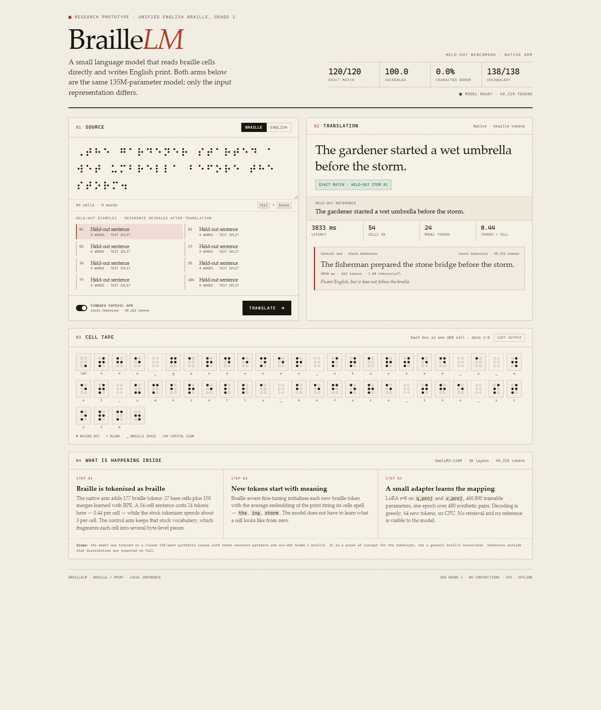

# BrailleLM — a braille → print proof of concept

**Neural Mac capstone run (4 November 2026):** See the
[`neural_mac/` experiment package](neural_mac/README.md) for the Qwen2.5-0.5B
adapter, executed results notebook, reproducible code, dataset provenance,
training traces, predictions, and presentation guide. The selected checkpoint
scored **216/399 (54.1%) strict exact** on a locked final set with four-beam
decoding. It scored **109/200 (54.5%)** on a plain development pilot and
**93/199 (46.7%)** on an extended development pilot.
The checkpoint is available from the linked GitHub release. These are
converter-generated Grade 1 braille results, not human-entered braille scores.

BrailleLM is a small, reproducible experiment that asks one question:

> If a language model is given a **braille-aware tokenizer** and its new braille
> embeddings are **initialised from the print text those cells represent**, does
> it translate Unified English Braille (UEB) into print text better — and more
> cheaply — than the same model reading raw Unicode braille with its stock
> tokenizer?

It is a go/no-go spike, not a production translator. The whole thing runs on a
CPU laptop with a 135M-parameter model, and it is deliberately small enough to
inspect end to end.

---

## Contents

- [Why braille needs its own tokenizer](#why-braille-needs-its-own-tokenizer)
- [The three arms (and the controls)](#the-three-arms-and-the-controls)
- [How the pipeline works](#how-the-pipeline-works)
- [Architecture](#architecture)
- [Live demo](#live-demo)
- [Repository layout](#repository-layout)
- [Quickstart](#quickstart)
- [Running the experiments](#running-the-experiments)
- [Command reference](#command-reference)
- [What the metrics mean](#what-the-metrics-mean)
- [Outputs](#outputs)
- [Verification and known fixes](#verification-and-known-fixes)
- [Results from the reference run](#results-from-the-reference-run)
- [Project artifacts](#project-artifacts)
- [Limitations and non-goals](#limitations-and-non-goals)
- [Troubleshooting](#troubleshooting)

---

## Why braille needs its own tokenizer

Braille in Unicode lives at `U+2800`–`U+28FF`: 64 possible six-dot cells plus a
blank cell. A general-purpose BPE tokenizer has almost never seen these
characters in pretraining, so it usually falls back to one token per cell, or
even per byte of the UTF-8 encoding. A short braille word can cost several
tokens, and the model has to learn the mapping from cell sequences to English
from scratch.

This project tests a different arrangement:

1. **A braille-native vocabulary.** Start from the 64 cells and learn BPE merges
   over the *braille* side of the training data. Frequent cell sequences
   (contractions, common words) collapse into a single token. On the bundled
   600-sentence corpus the token list has 177 entries — 27 base cells seen in
   training plus 150 merges — which grows SmolLM2-135M's vocabulary from
   **49,152 to 49,329**.
2. **BKFT initialisation.** A newly added braille token is not left at a random
   embedding. Its cells are expanded to the print string they represent, and the
   new embedding is set to the **mean of the base model's embeddings for that
   print string**. For example, a token for the first three cells of `the`
   expands to `"the"`, so its embedding becomes the average of the base
   embeddings of the token(s) for `"the"`. Indicators (capital `⠠`, number
   `⠼`, blank/space) expand to nothing, and a token with no usable expansion
   falls back to the global mean of the base embeddings.

The hope is that this gives the model a sensible starting point for braille
tokens, instead of asking LoRA to invent one from noise. Whether that actually
helps is the point of the controlled experiment.

---

## The three arms (and the controls)

`run_experiment.py` trains three arms with the same data, seed, LoRA settings and
number of epochs. The only differences are the tokenizer and the embedding
initialisation.

| Arm | Tokenizer | New embeddings | What it tests |
|---|---|---|---|
| `baseline` | stock tokenizer, raw Unicode braille | none added | the conventional approach |
| `native-random` | braille-native vocabulary | random `N(0, 0.02)` | tokenizer without the initialisation trick |
| `native-bkft` | braille-native vocabulary | BKFT, print-anchored | the full proposal |

Two comparisons carry the argument:

- **`native-bkft` vs `baseline`** — the combined value of the braille-native
  tokenizer and BKFT over the conventional approach.
- **`native-bkft` vs `native-random`** — the value of BKFT *specifically*,
  holding the tokenizer fixed. This is the key control. If native-bkft and
  native-random perform the same, the initialisation is not doing the work.

Embeddings are **frozen by default**, so the quality of the initialisation stays
visible throughout training instead of being washed out by gradient updates.
Pass `--train_embeddings` to let the new rows train as well.

---

## How the pipeline works

```
sentences (built-in list or --input file)
        │
        ▼
  UEB conversion  ──────────────►  braille strings
        │                              │
        │                              ▼
        │                     round-trip filter
        │              (keep only pairs that back-translate
        │               to the original, case-insensitively)
        ▼                              │
  random or word-disjoint split  ◄─────┘
        │
        ├── data/train.jsonl   {"braille": "...", "print": "..."}
        └── data/test.jsonl
                 │
                 ▼
  braille BPE over train braille  ──►  braille_tokens.json
                 │
                 ▼
   train.py (three arms)  ──►  out_<arm>_seed<N>/
                 │                 adapter, tokenizer, loss curve, metadata
                 ▼
              eval.py  ──►  eval.json  (BLEU, CER, exact match, tokens/cell)
                 │
                 ▼
   run_experiment.py  ──►  mean ± spread across seeds + experiment_results.json
```

### Data preparation

`prep_data.py` converts each English sentence to braille and immediately
back-translates it. A pair is kept only if the round trip reproduces the
original sentence case-insensitively. That means every training and test label
is known to be correct for the converter that produced it — no silently wrong
targets.

The converter is either **liblouis** (if the Python bindings are installed) or
the bundled `braille_ueb.py` engine:

- **Grade 1 (uncontracted)** is an exact, invertible letter↔cell mapping.
- **Grade 2 (contracted)** is a subset of common UEB groupsigns, not the full
  standard. The round-trip filter removes anything the subset cannot represent.

The default run is Grade 1, because it is exact and keeps the first experiment
honest. `--grade 2` is available for a harder, more realistic variant.

### Splits

- **`--split random`** (default): shuffle the pairs and hold out
  `--test_frac` (default 20%). This measures performance on unseen *sentences*
  drawn from the same vocabulary.
- **`--split word_disjoint`**: shuffle the vocabulary, hold out
  `--holdout_frac` of it (default 15%), and send every sentence containing a
  held-out word to the test set. The script asserts that every test sentence
  contains at least one word never seen during training. This tests
  generalisation to unseen *words*, not just unseen orderings.

With the bundled 600-sentence corpus and `--holdout_frac 0.05`, the vocabulary
is 138 unique words, 6 are held out, and the split is **459 train / 141 test**
with `every_test_has_unseen_word: true`. Because the split is by vocabulary,
the test fraction (23.5%) can be much larger than the holdout fraction.

### The tokenizer

`braille_tokenizer.py` learns merges only over the braille side of
`data/train.jsonl`, never merging across a space or line break. It adds:

- every base cell that appears in training,
- the capital, number and blank indicators when present,
- the merged tokens.

The token list and merge counts are written to `braille_tokens.json`. The same
tokenizer is shared by both native arms, so the tokenizer comparison is fair.

### Training details

`train.py` fine-tunes a causal LM with LoRA:

| Setting | Default |
|---|---|
| Base model | `HuggingFaceTB/SmolLM2-135M` |
| LoRA rank / alpha / dropout | 8 / 16 / 0.05 |
| LoRA target modules | `q_proj`, `v_proj` |
| Effective batch size | 2 × 8 gradient accumulation = 16 |
| Learning rate | 1e-4 (AdamW) |
| Epochs | 3 (via the runners; `train.py` alone defaults to 1) |
| Max sequence length | 256 |
| Validation | 10% of train, loss curve only |
| Seeds | `0`, `1`, `2` in the experiment runner |

The prompt is fixed:

```text
Translate the following braille to English text.
Braille: <braille>
English:
```

The target is `" " + English + eos`. Prompt tokens are masked with `-100`, so
loss is computed on the answer only. Because SmolLM2 ties input and output
embeddings, the added rows live in a single embedding matrix. Those rows are
**frozen by default** so the initialisation stays measurable. If you pass
`--train_embeddings`, `embed_tokens` and `lm_head` are added to LoRA
`modules_to_save` so the new rows can train (and the tied weight is saved
correctly).

One subtlety that caused a real bug: long braille prompts can push the English
answer past `max_len`. If the answer is truncated away, the label row is all
`-100` and the loss becomes NaN. `build_example` now trims the **prompt from the
left** and always keeps the answer.

### Evaluation

`eval.py` reloads the base model, resizes to the saved tokenizer, attaches the
LoRA adapter, and generates greedily (`do_sample=False`, 64 new tokens max).
Only the first generated line is treated as the hypothesis. It then computes the
metrics below on `data/test.jsonl`.

---

## Architecture

BrailleLM is a file-based pipeline with three layers. Each stage reads files
from disk and writes files to disk, so any stage can be rerun in isolation.

| Layer | Components | Responsibility |
|---|---|---|
| Representation and data | `braille_ueb.py`, `prep_data.py` | convert print↔braille, enforce the round-trip invariant, split the pairs |
| Model adaptation | `braille_tokenizer.py`, `train.py` | learn the braille vocabulary, expand the model, initialise the new rows, train LoRA adapters |
| Measurement | `eval.py`, `run_experiment.py`, `run_all.py` | generate, score, aggregate across arms and seeds |

The model path in one line:

```text
SmolLM2-135M (30 layers, 576 hidden, tied embeddings, 49,152 vocab)
  → +177 braille tokens (49,329)
  → new rows random-init or BKFT-init
  → LoRA r=8 on q_proj / v_proj, base weights frozen
  → prompt tokens masked, loss on the English answer only
```

The data path in one line:

```text
sentences → UEB braille → round-trip filter → split → JSONL
         → BPE over braille cells → token list → train → eval → aggregate
```

The detailed component map, data schemas, tensor layout, BKFT formula, training
loop, orchestration sequence and design trade-offs are in
[ARCHITECTURE.md](ARCHITECTURE.md).

---

## Live demo

A local web app runs the merged native checkpoint and the baseline side by side
on your machine. It is the fastest way to see the claim, and it is designed to
be shown in a presentation.



```bash
# Download the native checkpoint first (see demo/README.md), then:
python demo/server.py --open
```

The page opens at `http://127.0.0.1:7860`, loads the model in the background,
and serves eight held-out examples. For each input it shows the native
translation, the control arm's translation, latency, token counts, tokens per
cell, and a six-dot cell tape. The reference is revealed only after the model
answers. Add `?run=1&sample=2` to the URL to auto-run a sample during rehearsal.

The demo needs no API key and no network after the checkpoint is on disk. See
[`demo/README.md`](demo/README.md) for checkpoint paths, flags, and
troubleshooting.

---

## Repository layout

```text
.
├── braille_ueb.py          UEB conversion + braille→print inverse (Grade 1 exact, Grade 2 subset)
├── prep_data.py            build, round-trip-filter and split the dataset
├── braille_tokenizer.py    learn the braille-native BPE vocabulary
├── train.py                fine-tune baseline / native (random or BKFT init)
├── eval.py                 BLEU, CER, exact match, tokens per cell
├── run_all.py              two-arm smoke test, cross-platform (Python)
├── run_all.sh              same smoke test in bash
├── run_experiment.py       three arms × N seeds, mean ± spread, controls
├── test_wiring.py          model-level checks with a tiny local model, no download
├── sentences.txt           600-sentence input corpus
├── requirements.txt        Python dependencies
├── ARCHITECTURE.md         components, data flow, model and experiment design
├── demo/                   local web demo: live native model + control arm
├── docs/                   report PDF/HTML and the results write-up
├── benchmark/              120 held-out items, prompts, references, scorer
├── results/                predictions, comparison pack, timings
├── models/                 baseline LoRA adapter and native model instructions
└── README.md
```

Generated at runtime and intentionally not committed: `data/`,
`braille_tokens.json`, `out_*/`, `experiment_results.json`, `__pycache__/`.
The 652 MB native checkpoint is a release asset, not a git object; see
[`models/README.md`](models/README.md).

---

## Quickstart

Requirements: Python 3.10–3.12, ~1 GB of disk for the small model and outputs,
and network access the first time the base model is downloaded from Hugging
Face. A CUDA GPU is optional.

```bash
git clone https://github.com/Yuvraj0967/braillelm-poc.git
cd braillelm-poc

python -m venv .venv
# Windows (PowerShell):
.venv\Scripts\Activate.ps1
# macOS / Linux:
source .venv/bin/activate

# Install the CPU build first so pip does not pull a large CUDA wheel.
pip install torch --index-url https://download.pytorch.org/whl/cpu
pip install -r requirements.txt
```

Optional, for full UEB instead of the built-in engine:

```bash
pip install louis          # if the Python bindings install on your platform
```

If liblouis is unavailable, `prep_data.py` prints a notice and uses the bundled
engine automatically. The training pipeline does not care which produced the
data.

### Smoke test (two arms)

```bash
python run_all.py --input sentences.txt
```

This runs: data prep → braille tokenizer → baseline train/eval → native
train/eval → a small comparison table. It uses 3 epochs by default and writes
`out_baseline/` and `out_native/`.

On a CPU laptop this is not instant; see
[Results from the reference run](#results-from-the-reference-run).

### Wiring check (no model download)

After preparing data and tokens:

```bash
python prep_data.py --grade 1 --out data --input sentences.txt
python braille_tokenizer.py --data data --num_merges 150 --out braille_tokens.json
python test_wiring.py
```

`test_wiring.py` builds a tiny Llama-style model and tokenizer locally and
reproduces the risky model-level operations: add tokens → resize → BKFT init →
LoRA with `modules_to_save` → a real train step → generation. It should end
with `ALL WIRING CHECKS PASSED`.

---

## Running the experiments

The controlled experiment is the one whose result holds up, because it includes
the random-init control and repeats across seeds.

### Word-disjoint generalisation (recommended)

```bash
# Time one seed first:
python run_experiment.py --seeds 0 --input sentences.txt \
    --split word_disjoint --holdout_frac 0.05

# Then all three seeds:
python run_experiment.py --seeds 0 1 2 --input sentences.txt \
    --split word_disjoint --holdout_frac 0.05
```

### Random split

```bash
python run_experiment.py --seeds 0 1 2 --input sentences.txt
```

### Grade 2

```bash
python run_experiment.py --seeds 0 1 2 --input sentences.txt --grade 2
```

### GPU

```bash
python run_experiment.py --seeds 0 1 2 --input sentences.txt \
    --gpu --bf16 --model Qwen/Qwen2.5-0.5B-Instruct
```

The runner prints a `RESULTS` table with mean ± population standard deviation
for every metric and arm, followed by three control lines. It also writes
`experiment_results.json` containing both the aggregates and the raw per-seed
values.

With three seeds, the ± value is a spread indicator, not a significance test.
Do not read a 0.1 BLEU difference with overlapping spreads as a real effect.

---

## Command reference

### `prep_data.py`

| Flag | Default | Meaning |
|---|---|---|
| `--grade` | `1` | UEB grade (1 exact, 2 contracted subset) |
| `--input` | built-in list | text file, one sentence per line |
| `--out` | `data` | output directory |
| `--test_frac` | `0.2` | test fraction for a random split |
| `--seed` | `0` | shuffle seed |
| `--split` | `random` | `random` or `word_disjoint` |
| `--holdout_frac` | `0.15` | vocabulary fraction held out (word-disjoint only) |

Writes `train.jsonl`, `test.jsonl`, and `meta.json` (counts, engine, whether
every test item has an unseen word).

### `braille_tokenizer.py`

| Flag | Default | Meaning |
|---|---|---|
| `--data` | `data` | directory containing `train.jsonl` |
| `--num_merges` | `150` | maximum BPE merges |
| `--out` | `braille_tokens.json` | token list + merge record |

### `train.py`

| Flag | Default | Meaning |
|---|---|---|
| `--mode` | required | `baseline` or `native` |
| `--init` | `bkft` | native only: `bkft` or `random` |
| `--train_embeddings` | off | unfreeze the added embedding rows |
| `--model` | `HuggingFaceTB/SmolLM2-135M` | base model |
| `--data` | `data` | dataset directory |
| `--tokens` | `braille_tokens.json` | native token list |
| `--out` | `out_<arm>_seed<seed>` | checkpoint directory |
| `--epochs` | `1` | epochs (runners pass 3) |
| `--lr` | `1e-4` | AdamW learning rate |
| `--batch` | `2` | micro-batch size |
| `--grad_accum` | `8` | gradient accumulation |
| `--max_len` | `256` | sequence length |
| `--lora_rank` | `8` | LoRA rank |
| `--val_frac` | `0.1` | validation fraction |
| `--eval_every` | `25` | steps between loss-curve points |
| `--cpu` | off | force CPU / float32 |
| `--bf16` | off | bfloat16 on CUDA |
| `--seed` | `0` | seed |

### `eval.py`

| Flag | Default | Meaning |
|---|---|---|
| `--ckpt` | required | checkpoint directory |
| `--data` | `data` | dataset directory |
| `--max_new` | `64` | maximum generated tokens |
| `--cpu` | off | force CPU |
| `--limit` | `0` | evaluate only the first N rows |

### `run_all.py`

| Flag | Default | Meaning |
|---|---|---|
| `--model` | `HuggingFaceTB/SmolLM2-135M` | base model |
| `--grade` | `1` | UEB grade |
| `--epochs` | `3` | epochs |
| `--merges` | `150` | BPE merges |
| `--gpu` | off | use CUDA |
| `--input` | none | input sentence file |

### `run_experiment.py`

| Flag | Default | Meaning |
|---|---|---|
| `--seeds` | `0 1 2` | one or more seeds |
| `--model` | `HuggingFaceTB/SmolLM2-135M` | base model |
| `--grade` | `1` | UEB grade |
| `--epochs` | `3` | epochs |
| `--merges` | `150` | BPE merges |
| `--max_len` | `256` | sequence length |
| `--input` | none | input sentence file |
| `--split` | `random` | `random` or `word_disjoint` |
| `--holdout_frac` | `0.15` | vocabulary holdout |
| `--train_embeddings` | off | unfreeze added embeddings |
| `--gpu` | off | use CUDA |
| `--bf16` | off | bfloat16 on CUDA |

---

## What the metrics mean

| Metric | Direction | Definition |
|---|---|---|
| `sacrebleu` | higher is better | corpus BLEU via sacreBLEU (0–100), computed over the whole test set |
| `cer` | lower is better | mean character error rate: Levenshtein distance ÷ reference length |
| `exact_match` | higher is better | fraction of hypotheses identical to the reference (case-insensitive, stripped) |
| `tokens_per_cell` | lower is better | model tokens needed to encode the braille input ÷ number of braille cells |

`tokens_per_cell` is a property of the tokenizer, not of generation quality.
The native arms should be clearly lower than the baseline; that is the
efficiency claim. Accuracy is carried by BLEU, CER and exact match.

BLEU on short sentences is coarse, and exact match has a low ceiling on a small
corpus. The three metrics are reported together for that reason.

---

## Outputs

After a run:

```text
data/
  train.jsonl            459 pairs for the bundled word-disjoint 5% split
  test.jsonl             141 pairs
  meta.json              engine, grade, counts, split diagnostics

braille_tokens.json      base cells, merges, and the token list

out_baseline_seed0/
  adapter_config.json
  adapter_model.safetensors
  tokenizer files
  train_meta.json        arm, mode, init, seed, device, steps, final loss
  loss_curve.json        train/validation loss every --eval_every steps
  eval.json              BLEU, CER, exact match, tokens/cell, n

out_native-random_seed0/   ... same layout
out_native-bkft_seed0/     ... same layout

experiment_results.json  aggregates (mean/std) + raw values per seed
```

`train_meta.json` is what `eval.py` reads to find the base model, so the
checkpoint directory is self-describing.

---

## Verification and known fixes

The repository ships with `test_wiring.py`, which checks the parts most likely
to break, without downloading a model:

- a tiny from-scratch BPE tokenizer and tied-embedding Llama model;
- add braille tokens → resize → BKFT initialisation;
- a spot-check that a known token's embedding equals the mean of the print
  tokens (reported as `max|diff|`, ideally `0.00e+00`);
- LoRA with `embed_tokens` / `lm_head` in `modules_to_save` (the
  `--train_embeddings` path);
- one real forward/backward/step with a finite loss;
- greedy generation.

Two Windows issues found and fixed while running this on a CPU laptop:

1. `test_wiring.py` read `braille_tokens.json` without `encoding="utf-8"`,
   which crashes under the cp1252 default. Fixed.
2. `braille_tokenizer.py` printed Unicode braille to a cp1252 console. The file
   had already been written, but the process exited non-zero, so a runner
   treated a successful step as a failure. The script now reconfigures stdout
   to UTF-8 with replacement. Fixed.

A real training bug was also fixed: answer truncation could leave an all-masked
label row and produce NaN loss, especially in baseline mode where braille
fragments into many tokens. The prompt is now trimmed from the left and the
answer is always kept.

---

## Results from the reference run

The repository includes the completed **120-item** evaluation from the report:
600 synthetic sentences split 480 train / 120 test at random, SmolLM2-135M,
Grade 1, one epoch on CPU.

| Arm | Exact | CER | BLEU | Distinct outputs | Vocab emitted | Actor slot |
|---|---:|---:|---:|---:|---:|---:|
| **Native (braille tokens + BKFT)** | **120 / 120** | **0.0%** | **100.0** | 120 / 120 | 138 / 138 | **100%** |
| Baseline (raw braille) | 0 / 120 | 63.8% | 4.0 | 9 / 120 | 22 / 138 | 2.7% |
| Baseline, 256-token control | 0 / 120 | 60.2% | 4.2 | 15 / 120 | 29 / 138 | 8.0% |

What it shows: the native arm reproduces every held-out sentence, with all 120
outputs distinct and all 138 words covered. The baseline emits only 9 distinct
sentences for 120 different inputs, uses 22 words, and gets the actor right
2.7% of the time — fluent output that ignores the braille. The longer-sequence
control does not fix it.

What it does **not** show: this is a closed 138-word distribution with a random
split, so every test word also occurs in training. It is a strong
pipeline/learnability result, not open-domain braille translation. The
word-disjoint split is the harder generalisation test; run it yourself with the
command above. Full protocol, caveats and confidence intervals:
[`docs/RESULTS.md`](docs/RESULTS.md).

When you run the three-arm experiment, read the two control lines the runner
prints:

```text
tokenizer value  (native-bkft vs baseline), sacreBLEU
BKFT value       (native-bkft vs native-random), sacreBLEU
BKFT value       (native-bkft vs native-random), CER
```

If the tokenizer helps, native-bkft should beat baseline on accuracy **and**
need fewer tokens per cell. If BKFT helps, native-bkft should beat
native-random. If it does not, the honest conclusion is that the initialisation
is not carrying the result and the tokenizer alone is doing the work.

---

## Project artifacts

| Artifact | Location | What it is |
|---|---|---|
| Full report | [`docs/BrailleLM_Report.pdf`](docs/BrailleLM_Report.pdf) | 26 pages: protocol, model/data cards, vocabulary, all 120 rows, comparison kit |
| Report (HTML) | [`docs/braillelm_report.html`](docs/braillelm_report.html) | The same report as a standalone page |
| Results write-up | [`docs/RESULTS.md`](docs/RESULTS.md) | The 120-item numbers, interpretation and caveats |
| Live demo | [`demo/`](demo/) | Local web app with live native inference and the control arm |
| Benchmark kit | [`benchmark/`](benchmark/) | 120 braille inputs, references, prompts, few-shot examples, scorer |
| Raw results | [`results/`](results/) | Predictions for all three arms, comparison pack, timing measurements |
| Baseline adapter | [`models/baseline-lora/`](models/baseline-lora/) | 1.8 MB LoRA adapter, tracked in git |
| Native checkpoint | [`models/README.md`](models/README.md) | 652 MB merged model, published as a release asset |
| Architecture | [`ARCHITECTURE.md`](ARCHITECTURE.md) | Components, data flow, model adaptation, orchestration |

The comparison kit is the fair way to put another LLM against these numbers:
it fixes the prompt, the 120 items, the scoring code and the zero-shot
conditions. See [`benchmark/README.md`](benchmark/README.md).

---

## Limitations and non-goals

- **Not full UEB.** Grade 1 is exact for this engine. Grade 2 covers a subset of
  groupsigns, not the complete standard. For production, use liblouis tables
  (`en-ueb-g1` / `en-ueb-g2`).
- **Small, templated corpus.** The bundled 600 sentences use a 138-word
  vocabulary. That is enough to exercise the pipeline, not enough to claim
  state-of-the-art accuracy. Replace `sentences.txt` with a real corpus for
  meaningful numbers.
- **One small base model by default.** SmolLM2-135M is chosen so the experiment
  runs on CPU. Results may not transfer to larger models.
- **Frozen embeddings by default.** This is a deliberate design choice to make
  the initialisation visible. Use `--train_embeddings` for a different question.
- **`tokens_per_cell` is not latency.** It measures tokenizer efficiency, not
  wall-clock speed.
- **No formatting, no 8-dot braille, no math or music codes.** The engine handles
  letters, digits, common punctuation, capitals and the listed groupsigns.
- **Not a translator.** Do not use it to produce braille or print for real
  readers without human verification.

---

## Troubleshooting

**`liblouis unavailable`** — expected if the Python bindings are not installed.
The built-in engine is used and the run continues. Install `louis` for full UEB.

**`UnicodeEncodeError` on Windows** — use the fixed scripts in this repository,
or set UTF-8 mode for the session:

```powershell
$env:PYTHONUTF8 = "1"
```

```bash
export PYTHONUTF8=1
```

**Torch install is huge or fails on ARM** — install the CPU wheel first:

```bash
pip install torch --index-url https://download.pytorch.org/whl/cpu
```

If no wheel exists for your platform/Python version, use the default PyPI wheel
or a supported Python version. The code only needs CPU float32.

**`WARNING: empty split`** — the vocabulary holdout sent every sentence to one
side. Increase the corpus, lower `--holdout_frac`, or use `--split random`.

**The first run seems to hang** — it is probably downloading the base model, or
training on CPU. `train.py` writes the checkpoint only after all epochs, so
`out_*/` may not exist for a while. Watch CPU usage rather than the directory.

**NaN loss** — this was fixed in `build_example`. If you modify sequence
handling, keep the guarantee that the answer is never fully truncated.
