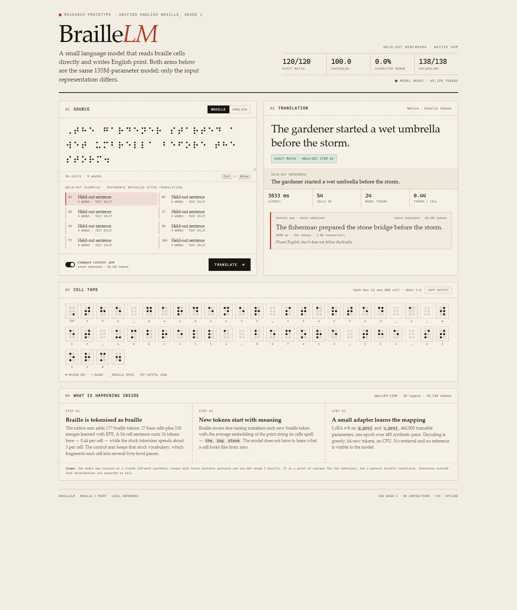

# Live demo

A local, single-page demonstration of the trained BrailleLM checkpoint. You
type or paste Unified English Braille, the native model translates it live on
your machine, and the page shows the output, the cell-by-cell input, token
costs, and — optionally — what the baseline arm says about the same input.

Everything runs offline after the model is on disk. There is no API key, no
cloud service, and no build step.



## What the teacher sees

- **A live translation** from the merged native checkpoint, not a recording.
  The same held-out sentences from the report can be loaded with one click,
  and the reference is revealed only after the model answers.
- **The control arm beside it.** The baseline uses the stock tokenizer and
  produces fluent English that usually ignores the braille. That contrast is
  the point of the project.
- **The cell tape.** Each input cell is drawn as a six-dot braille cell, so
  the input representation is visible rather than assumed.
- **Honest numbers.** 120/120 exact, 100.0 sacreBLEU, 0.0% CER on the held-out
  set; 24 tokens for a 54-cell sentence in the native arm versus a much larger
  token count in the control arm. The benchmark numbers are read from
  `benchmark/reference_scores.json`; the translations and token counts in the
  page are computed live.

The demo is deliberately scoped: the model was trained on a closed 138-word
synthetic corpus with three sentence patterns. Use the held-out examples for a
clean demonstration. Free-form English from outside that vocabulary is expected
to fail, and the page says so.

## Requirements

- Python 3.10–3.12 with the project requirements installed
  (`pip install -r requirements.txt`; PyTorch CPU is enough).
- The merged native checkpoint (~652 MB).
- Optional: the baseline adapter in `models/baseline-lora/` for the comparison
  panel. It is already in the repository.

## Get the native checkpoint

Download the release asset and extract it:

```bash
curl -L -o braillelm-native-smollm2-135m.tar \
  https://github.com/Yuvraj0967/braillelm-poc/releases/latest/download/braillelm-native-smollm2-135m.tar

mkdir -p models
tar -xf braillelm-native-smollm2-135m.tar -C models
```

That produces `models/braillelm_native/`. The server looks for the checkpoint in
these locations, in order:

1. `--native-model <dir>`
2. `models/braillelm-native/`
3. `models/braillelm_native/`
4. `../braillelm_delivery/braillelm_native/`
5. `../braillelm_native/`
6. `~/braillelm_native/`

If you already have the checkpoint somewhere else, pass its directory:

```bash
python demo/server.py --native-model /path/to/braillelm_native --open
```

## Run it

From the repository root:

```bash
python demo/server.py --open
```

The server starts on `http://127.0.0.1:7860`. The page opens immediately and
shows “warming up the model” while the checkpoint loads in the background
(about 10–15 seconds on CPU). The Translate button enables when the status line
turns green.

Useful flags:

| Flag | Meaning |
| --- | --- |
| `--open` | Open the default browser when the server starts. |
| `--port 8000` | Use a different port. |
| `--host 0.0.0.0` | Listen on the network instead of localhost. Only do this on a trusted network. |
| `--native-model <dir>` | Point at a checkpoint outside the default search paths. |
| `--no-baseline` | Skip loading the control arm (saves memory and startup time). |
| `--baseline-adapter <dir>` | Use a different baseline adapter. |

Press `Ctrl+C` in the terminal to stop it.

## Using the page

- **Braille tab.** Paste Unicode braille (U+2800–U+28FF), or click a held-out
  example. The braille word separator is U+2800.
- **English tab.** Type a sentence and the server encodes it to Grade 1 braille
  with `braille_ueb.to_braille()` before translating. This is the easier mode
  for an audience that does not read braille. Stick to the corpus vocabulary.
- **Compare control arm.** On by default. The first comparison may wait a few
  seconds while the baseline adapter loads; the page shows its status under the
  switch.
- **Ctrl+Enter** (or Cmd+Enter) runs a translation.
- The verdict under the translation appears only when the input exactly matches
  a held-out test item, and reports whether the model matched the reference.
- To rehearse without clicking, add `?run=1&sample=2` to the page URL. The page
  waits for the model, loads that held-out example, and runs it automatically.

## What is happening on each request

1. The page posts the input to `/api/translate` on the local server.
2. The server normalises the braille, counts cells, and builds the same prompt
   used in `eval.py`:
   `Translate the following braille to English text.\nBraille: …\nEnglish:`
3. The native model generates greedily, up to 64 new tokens.
4. If the control arm is enabled, the baseline adapter generates from the same
   prompt with the stock tokenizer.
5. The server returns both outputs, latencies, token counts, tokens-per-cell,
   the cell map, and — for a held-out input — the reference and exact-match
   result.

Generation is serialised behind a lock. On a CPU-only laptop a translation
takes roughly 2–5 seconds; the control arm roughly the same.

## Troubleshooting

**“Native checkpoint not found.”** Download and extract the release asset as
above, or pass `--native-model`.

**The status stays amber.** The first load reads a 652 MB safetensors file and
builds the model. On a slow disk this can take 20–30 seconds. The terminal
prints `[demo] native ready in …` when it is done.

**“Control arm unavailable.”** The baseline adapter needs the stock
`HuggingFaceTB/SmolLM2-135M` weights. They are downloaded automatically on the
first run, or reused from the Hugging Face cache. Run with `--no-baseline` if
you do not need the comparison.

**Port already in use.** Use `--port 8000` and open
`http://127.0.0.1:8000`.

**Nothing matches.** Confirm the input is Unicode braille, not ASCII braille or
print. Use the Braille tab with an example to verify the pipeline, and keep
English input to the 138-word corpus.

## Files

| File | Purpose |
| --- | --- |
| `server.py` | Standard-library HTTP server, model loading, generation, JSON API. |
| `index.html` | The complete interface: markup, CSS, and JavaScript in one file. |
| `preview.png` | Screenshot of a live run on a held-out sentence. |
| `README.md` | This document. |

The server has no third-party web framework. The model stack is the one in
`requirements.txt`.
